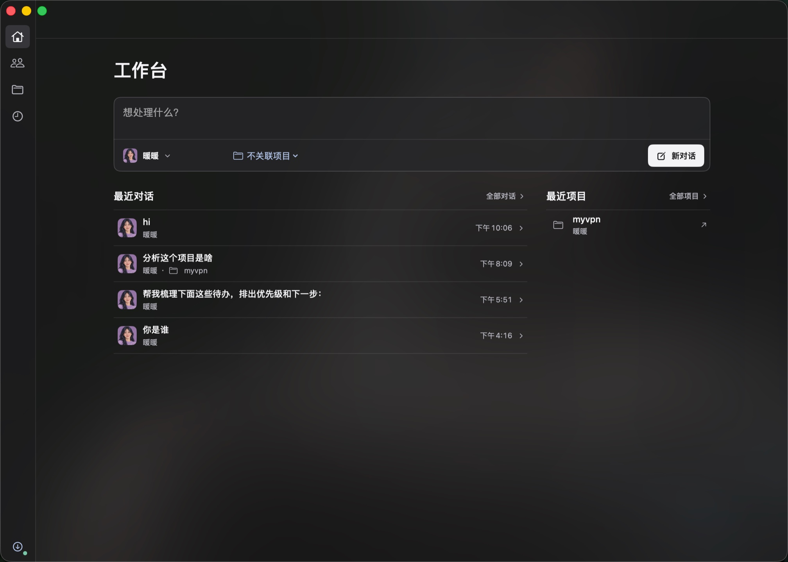
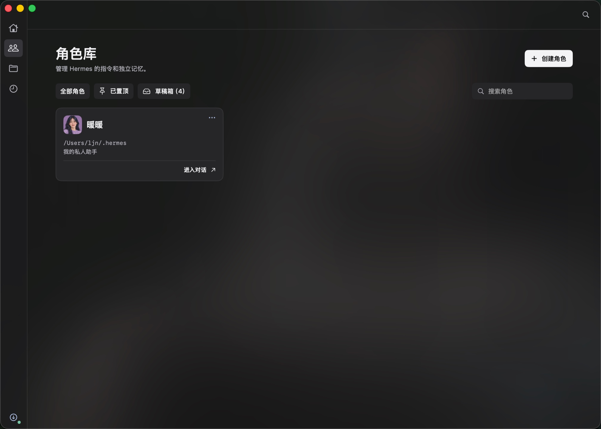
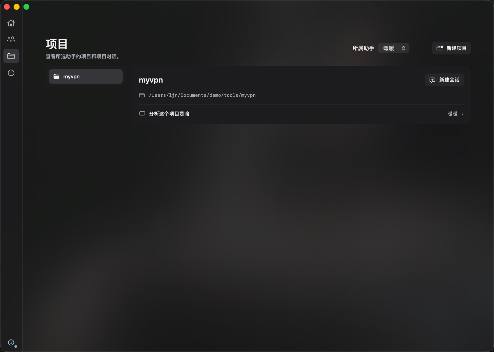
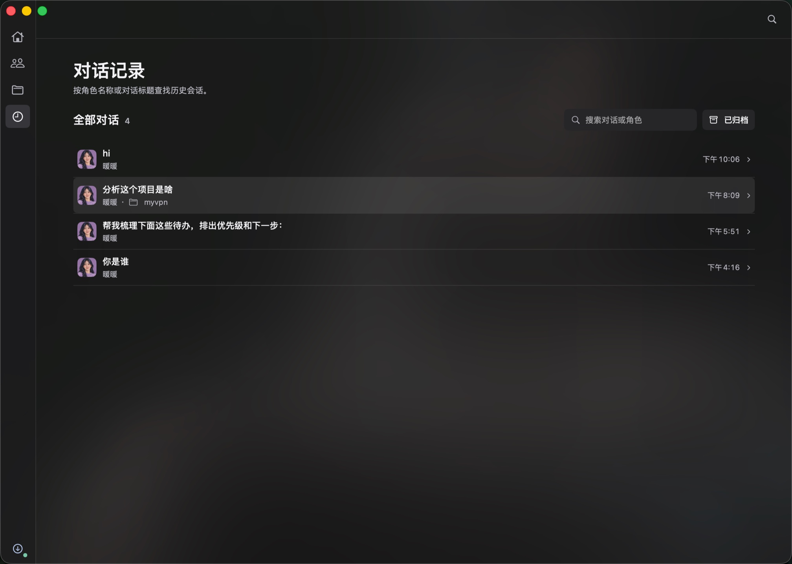
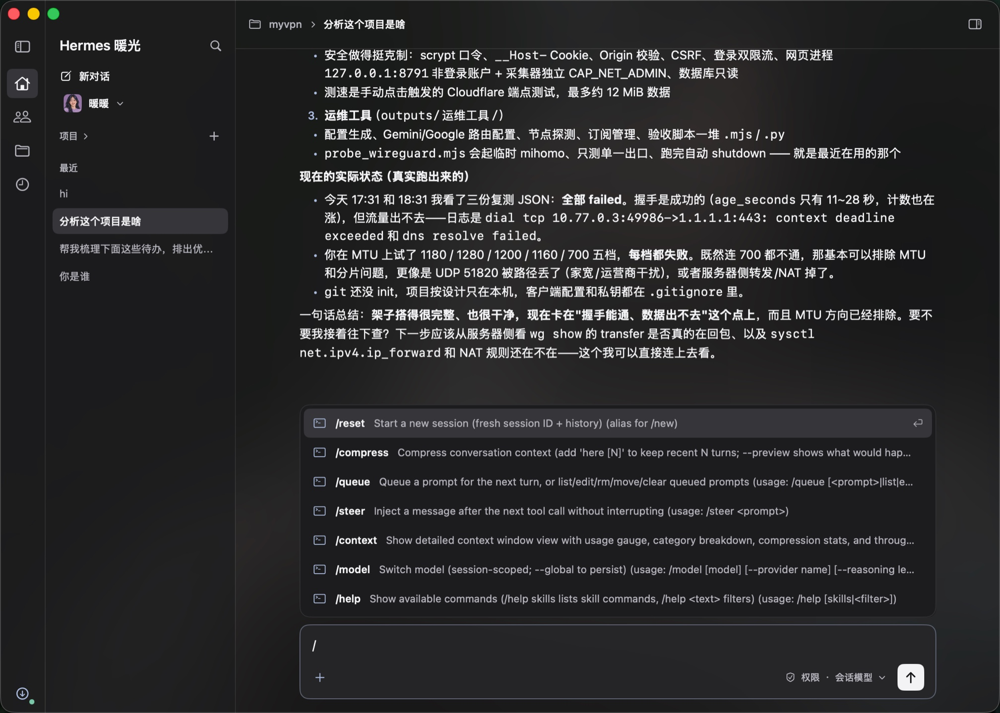
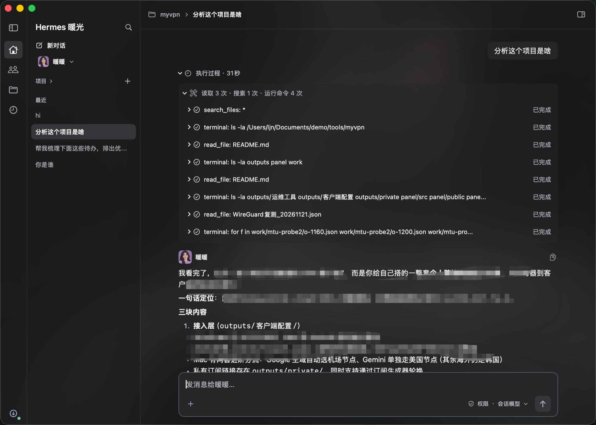

<p align="center">
  
</p>

<h1 align="center">暖光</h1>

<p align="center"><strong>以角色为入口的 Hermes macOS 客户端：每个角色有自己的记忆、项目和会话。</strong></p>

<p align="center">
  简体中文
</p>

<p align="center">
  
  
  
  
  
</p>

<p align="center">
  <a href="#overview">项目概览</a> · <a href="#preview">界面图墙</a> · <a href="#roles">角色与记忆</a> · <a href="#chat">对话与执行过程</a> · <a href="#projects">项目</a><br>
  <a href="#runtime">运行设置</a> · <a href="#install">安装</a> · <a href="#data">数据与隐私</a> · <a href="#structure">项目结构</a> · <a href="#development">开发验证</a> · <a href="#faq">常见问题</a> · <a href="#docs">文档导航</a>
</p>

<a id="overview"></a>

## 项目概览

暖光是本机 Hermes Agent 的图形外壳，不是另一个助手。它通过本机 `hermes` 的 ACP 接口发消息、收流式回复、跑工具、恢复历史会话，模型、技能、审批规则仍然由你原来的 Hermes 配置决定。

它把终端里「一个人一个 `HERMES_HOME`」的做法搬到了桌面上：每个角色是一份独立的运行目录，角色之间记忆、项目、会话互不可见；工作台按角色发起新对话，侧栏按角色看历史，切角色等于换人。

- **不接云端**：没有账号体系，不上传对话。应用只和你本机的 `hermes` 进程通信，模型请求由 Hermes 自己按已配好的密钥发出。
- **不改你的终端数据**：每次运行都显式把 `HERMES_HOME` 指到角色自己的 `runtime/`，终端 Hermes 的 `MEMORY.md`、`USER.md` 读写前后保持一致。
- **不做壁纸式仪表盘**：打开就是工作台，一个输入框加最近对话、最近项目；管角色、管对话、管项目各自一页，没有推荐流。
- **不托管你的文件**：新建项目会真的建目录，关联目录就指向那里；聊天历史仍写在应用自己的数据目录。

| 领域 | 当前能力 |
| --- | --- |
| 角色 | 工作台按角色发起对话；角色库查看全部角色、已置顶、草稿箱（3 个内置头像与自定义头像） |
| 记忆 | 每角色独立 `SOUL.md` / `MEMORY.md` / `USER.md`，可在「角色设定」「独立记忆」里直接编辑 |
| 对话 | 流式回复、Markdown 渲染、图片附件、技能选择、回合内补话、置顶与归档 |
| 执行过程 | 相邻工具合并显示，展开看每项调用的参数与结果；完成后显示耗时，最终答复单独呈现 |
| 项目 | 每角色独立项目；新建目录或关联已有目录，项目会话以该目录为工作目录 |
| 审批 | Hermes 请求审核时展示命令、文件改动前后内容与该项请求支持的审核选项 |
| 运行设置 | 输入框右下角统一设置编辑权限、模型、推理强度；新对话可在首条消息前设好 |
| 技能 | 输入 `/` 搜索当前角色可用技能；角色可选继承本机技能或只启用勾选项 |
| 更新 | 左下角「本机 Hermes」检测 CLI 新版本，并给出 `hermes update` 提示 |
| 外观 | 石墨灰半透明材质，底色随显示器壁纸轻微变化；系统「减少透明度」时用实底 |
| 数据 | 角色数据在 `~/hermesgroup/`，首次升级自动迁移旧目录并修正项目路径 |

**当前版本：0.4.7**（`macOS/Info.plist`）

<a id="preview"></a>

## 界面图墙

截图均为真实渲染，点击任意图片查看原图。图墙只放真实界面截图，不使用拼图或示意图。

### 工作台 · 起点

<a href="docs/assets/screenshots/workbench.jpg"></a>

<p align="center"><strong>一个输入框，加最近对话与最近项目</strong><br>左上角选角色，也可以不关联项目直接开聊；最近对话按时间倒序，点标题继续上一次的上下文</p>

<table>
  <tr>
    <td width="50%" valign="top" align="center">
      <a href="docs/assets/screenshots/roles-library.jpg"></a>
      <p><strong>角色库 · 全部角色 / 已置顶 / 草稿箱</strong><br>卡片显示角色名、简介与运行目录，右上「添加角色」用自然语言拟定草稿</p>
    </td>
    <td width="50%" valign="top" align="center">
      <a href="docs/assets/screenshots/projects.jpg"></a>
      <p><strong>项目 · 只列当前角色的项目</strong><br>项目显示关联的真实路径与所属助手；新建项目建目录，新建会话直接用该目录当工作目录</p>
    </td>
  </tr>
  <tr>
    <td width="50%" valign="top" align="center">
      <a href="docs/assets/screenshots/conversation-history.jpg"></a>
      <p><strong>对话记录 · 按角色名或标题搜索</strong><br>标题旁标出所属角色与项目，右侧「已归档」进入归档页，恢复后回到原角色和项目</p>
    </td>
    <td width="50%" valign="top" align="center">
      <a href="docs/assets/screenshots/chat-slash-commands.jpg"></a>
      <p><strong>输入 <code>/</code> 展开命令与技能</strong><br>斜杠列表同时给出命令说明和参数形式，回车发送、Shift＋回车换行</p>
    </td>
  </tr>
</table>

### 对话 · 执行过程

<a href="docs/assets/screenshots/chat-tool-trace.jpg"></a>

<p align="center"><strong>相邻工具合成一行「执行过程 · 31 秒」</strong><br>折叠时只报次数（读取 3 次 · 搜索 1 次 · 运行命令 4 次），展开后逐条看 <code>search_files</code>、<code>terminal</code>、<code>read_file</code> 的参数与返回，答复不受工具噪声打断</p>

<a id="roles"></a>

## 角色与记忆

- 应用打开进入工作台，可以选角色发起新对话，也能从最近对话继续；侧栏提供角色库、项目和对话记录入口。
- 每个角色拥有独立的 Hermes 运行目录，记忆、会话和操作状态都在自己的目录下；右栏可直接打开当前角色的目录。
- 「角色设定」编辑 `SOUL.md`，「独立记忆」查看和编辑 `MEMORY.md`、`USER.md`；在对话里也可以直接请角色记住一件事。
- 角色名称、简介、头像和指令均可自定义。复制角色模板只带指令和技能选项，新角色从空白记忆开始。
- 普通角色可移入「角色草稿箱」，保留资料、头像、记忆和会话 30 天；恢复沿用原角色 ID，确认后连同本地数据移入 macOS 废纸篓。
- 点工作台上的「终端 Hermes」进入桌面会话，首次聊天或编辑时复制终端角色指令与记忆；「详细信息」可查看原终端目录。

<a id="chat"></a>

## 对话与执行过程

- 支持添加或拖入图片、`⌘V` 粘贴截图或访达图片文件；读取图片需要视觉模型，或 Hermes 配置的视觉辅助模型。
- 相邻工具调用合并显示，展开可查看每项操作和结果；完成时给出总耗时，最终答复单独呈现，Markdown、代码块、表格随流式内容即时成型。
- 回复期间可以把普通文字插入当前任务，Hermes 原生控制会让同一回合接着处理补充内容；回合已结束时补充内容留在输入框。
- Hermes 请求审核时，展示涉及的命令、文件修改前后内容或其他请求详情，并提供该请求支持的审核选项。
- 置顶对话出现在当前角色侧栏的「已置顶」区；归档会把对话移入工作台的「已归档对话」，恢复时保留消息、项目和置顶状态。
- 新会话的开场建议使用当前角色的独立记忆；快速补全按当前角色和项目匹配已发送的消息。

<a id="projects"></a>

## 项目

- 每个助手有自己的项目和项目对话；工作台「项目」页、聊天中的项目选择与对话移动，都只使用当前助手的项目。
- 新建项目会在 macOS 上真的创建目录；关联已有目录后，项目会话以该目录作为 Hermes 工作目录。
- 项目映射和聊天历史写在应用数据目录，项目文件留在你选的位置，不会复制一份进去。
- 项目目录移动后会明确提示重新关联，历史会话保留；升级时旧项目按历史对话的助手归属登记，多个助手共用的旧项目各自保留入口。

<a id="runtime"></a>

## 运行设置

- 输入框右下角展示当前会话的编辑权限、模型和推理强度，可在发出首条消息前设定；回复结束后再调整。
- 「自动允许」放行工作区和临时目录的普通编辑，「免审批」只针对本对话的普通编辑；敏感路径与命令审批仍由 Hermes 处理。
- 聊天使用 Hermes 默认模型和受支持的 API 密钥配置；模型列表、推理强度选项来自本机 Hermes 当前会话的能力。
- 技能输入 `/` 或 `/skill` 搜索，候选范围由角色的启用选项决定：继承模式随技能库更新，仅启用所选时新装技能需手动勾选。
- 左下角「本机 Hermes」显示当前模型名，点击可检测 CLI 更新；未找到时给出 `hermes acp --check` 与「重新检测本机」。

<a id="install"></a>

## 安装

### 1. 准备本机 Hermes

暖光自身不带模型，先确认终端里的 Hermes 可用：

```sh
hermes acp --check
```

### 2. 安装暖光

**方式一：下载 DMG**（Apple Silicon / macOS 14+）

从 [Releases](https://github.com/ArtLjn/hermes-studio/releases/latest) 下载 `Hermes-Studio-<版本>-arm64.dmg`，打开后把「Hermes 暖光」拖进「应用程序」。

应用只做本机临时签名、没有公证，首次打开被 Gatekeeper 拦下时右键「打开」，或执行：

```sh
xattr -dr com.apple.quarantine "/Applications/Hermes 暖光.app"
```

**方式二：从源码构建**

需要 macOS 14 或更新版本、Swift 5.10 或更新的工具链。仓库不改动任何系统设置，构建产物只落在 `dist/`。

```sh
git clone https://github.com/ArtLjn/hermes-studio.git
cd hermes-studio
bash scripts/build-app.sh
open "dist/Hermes 暖光.app"
```

脚本执行 `swift build -c release`，按 `macOS/Info.plist` 组装 `.app`、拷贝图标与内置头像，最后做本机临时签名。

### 3. 首次打开

- 应用从 `~/.local/bin/hermes`、`/opt/homebrew/bin/hermes`、`/usr/local/bin/hermes` 和 `PATH` 查找可执行文件；也可以用 `HERMES_STUDIO_EXECUTABLE` 指定绝对路径。
- 未签名应用首次打开可能被 Gatekeeper 拦下，按提示「仍要打开」即可。
- 角色数据默认落在 `~/hermesgroup/`，首次升级会从旧的应用数据目录迁移。

<a id="data"></a>

## 数据与隐私

- **不发往第三方**：暖光没有自建服务端、没有账号。所有消息与附件交给你本机的 `hermes` 进程，由它按你已配置的 provider 发出。
- **角色互相隔离**：每个角色一份 `runtime/`（`SOUL.md`、`memories/`、`workspace/`），`HERMES_HOME` 显式指向该目录，不会读到别的角色或终端 Hermes 的记忆。
- **终端数据不动**：桌面端与终端各自读自己的记忆文件；使用「终端 Hermes」卡片时才复制一份角色指令与记忆到桌面角色。
- **密钥不留库**：模型密钥通过子进程环境传递，角色配置只保存引用，不写入仓库里的任何文件。
- **删除即移入废纸篓**：草稿箱确认删除会把角色目录移到 macOS 废纸篓，可在 30 天内恢复。

```text
~/hermesgroup/
  roles/<角色 UUID>/
    role.json                    名称、简介、头像与技能启用选项
    conversations.json           会话、消息、项目引用、置顶与归档状态
    Projects/<项目名称>/          此角色新建的实体项目目录
    images/                      聊天图片附件
    runtime/
      SOUL.md                    角色指令
      memories/MEMORY.md         长期记忆
      memories/USER.md           用户偏好
      workspace/                 无项目对话的默认工作目录
```

<a id="structure"></a>

## 项目结构

```text
Sources/
  HermesStudio/                  SwiftUI 界面层
    HermesStudioApp.swift        应用入口与窗口
    StudioWindow.swift           主窗口与导航
    StudioModel.swift            界面状态编排（角色、会话、发送、审批）
    WorkbenchOverview.swift      工作台：输入框、最近对话、最近项目
    ManagementPane.swift         角色库 / 对话记录 / 已归档
    ProjectPane.swift            项目列表与新建
    ChatPane.swift               聊天主区
    ChatSidebar.swift            会话侧栏（置顶、最近）
    ChatComposer.swift           输入框、附件、技能选择
    ComposerRunSettings.swift    权限、模型、推理强度
    ChatTurnRow.swift            回合与「执行过程」折叠
    ChatMessageRow.swift         Markdown 消息渲染
    ToolPermissionCard.swift     审批卡片
    RoleEditors.swift            角色设定与独立记忆编辑器
    StudioAppearance.swift       材质、配色与半透明底色
  StudioCore/                    无 UI 的核心逻辑（可单测）
    ACPClient.swift              ACP 子进程与 JSON-RPC 流
    HermesRuntime.swift          hermes 可执行文件发现与进程环境
    HermesTurnInsertion.swift    回合内补话
    HermesRunSettings.swift      运行设置的读写与映射
    HermesUpdate.swift           CLI 版本检测
    RoleStore.swift              角色、会话、置顶归档、目录迁移
    ProjectStore.swift           项目映射与目录创建
    SkillCatalog.swift           已安装技能读取与启用范围
    MarkdownBlocks.swift         流式 Markdown 分块
Tests/
  StudioCoreTests/               核心逻辑与实时联调测试
  HermesStudioTests/             编辑器等界面组件测试
docs/                            截图资源与设计说明
macOS/                           Info.plist 与 App 图标
scripts/build-app.sh             构建、组装 .app、本机签名
```

<a id="development"></a>

## 开发验证

```sh
swift test
HERMES_STUDIO_LIVE_TEST=1 swift test
HERMES_STUDIO_VISION_TEST=1 swift test --filter testLiveHermesAcceptsImageInput
```

- 默认运行 **42 项测试，30 项实跑通过、12 项跳过**（跳过的是需要真实模型与已配置 Hermes 的联调用例），0 失败。
- 覆盖了角色与会话的隔离与重开、项目目录创建与关联、数据目录迁移、置顶归档状态、回合内补话、运行设置映射、Markdown 流式分块、更新版本比较和输入编辑器行为。
- 设 `HERMES_STUDIO_LIVE_TEST=1` 后，联调用例改用本机已配置的模型，验证技能调用、记忆隔离、项目会话恢复和工具调用；`HERMES_STUDIO_VISION_TEST=1` 会发送一张生成的纯色样图测图片输入。
- 涉及 Hermes 进程行为的断言在默认模式下用替身（临时目录 + 假的可执行文件）完成，只有打开环境变量才走真机。

<a id="faq"></a>

## 常见问题

**不装 Hermes 能用吗？**
不能。暖光是外壳，模型、技能、工具与审批都由本机 Hermes 提供；没装时左下角会显示「未检测到本机 Hermes」。

**会改我终端里的记忆和会话吗？**
不会。桌面端每次运行都把 `HERMES_HOME` 指到角色自己的 `runtime/`，终端 Hermes 的 `MEMORY.md`、`USER.md` 前后一致；只有「终端 Hermes」卡片会显式复制一份进来。

**需要联网或注册账号吗？**
不需要账号。只有模型请求需要网络，走的是你 Hermes 里已经配好的 provider 和密钥。

**图片和文件会传到哪里？**
作为会话附件交给你本机的 Hermes，再由它按模型配置发送；需要视觉能力的图会交给视觉模型或 Hermes 配置的视觉辅助模型。

**为什么应用没有上架 App Store？**
它要拉起本机 `hermes` 子进程、读写工作目录和记忆文件，属于非沙盒应用，因此只做本机临时签名分发。

**支持其他系统吗？**
目前只有 macOS 14+ 的原生客户端。终端版本直接用 `hermes` 即可。

<a id="docs"></a>

## 文档导航

| 文档 | 内容 |
| --- | --- |
| [docs/角色技能与文件目录规划.md](docs/角色技能与文件目录规划.md) | 技能继承与仅启用、智能创建角色、文件保存位置、与终端 Hermes 的边界 |
| `scripts/build-app.sh` | 构建、组装 `.app`、本机签名 |
| `macOS/Info.plist` | Bundle 版本、名称与标识 |

## 致谢与许可

- 界面使用 SwiftUI 与 AppKit，不引入第三方依赖。
- 内置头像与图标位于 `Sources/HermesStudio/Resources/`。
- 仓库目前未附 `LICENSE` 文件，按 GitHub 默认视为保留所有权利；如需在别处复用，先开一个 issue 说明用途。
